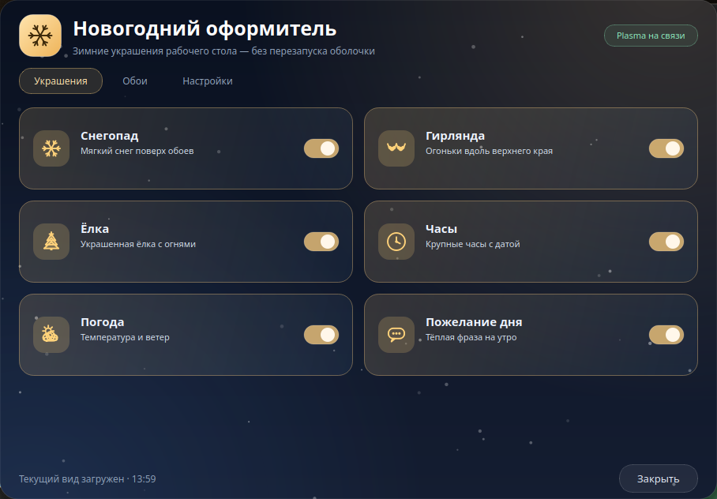
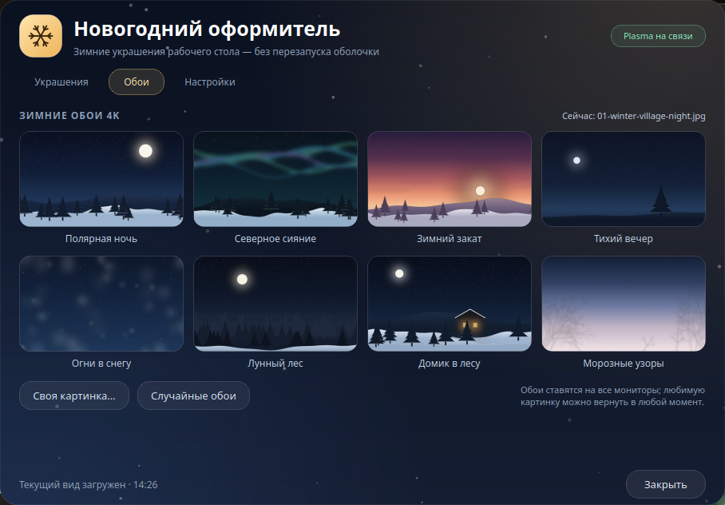
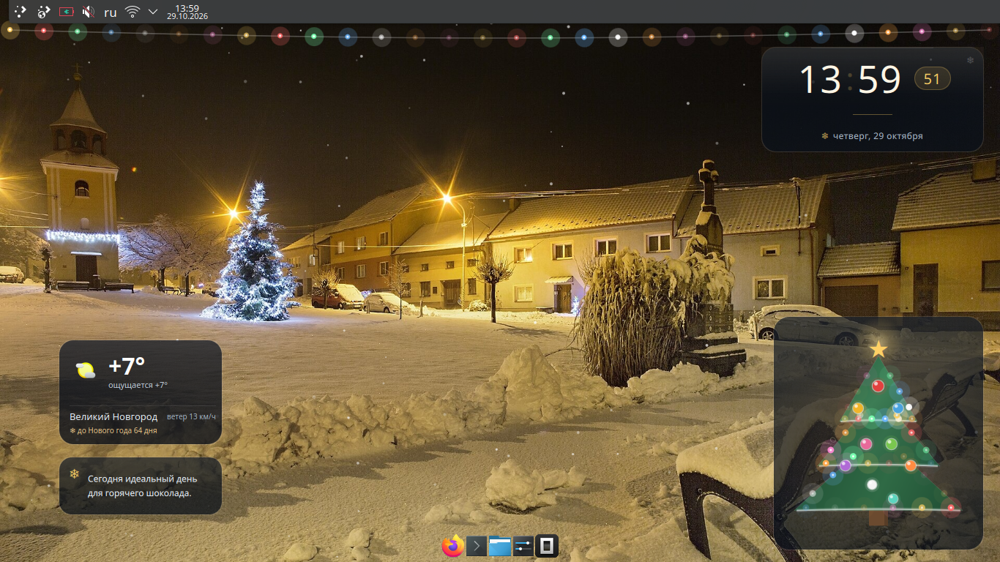

# Новогодний оформитель

Меню для KDE Plasma, которое включает и выключает зимние украшения рабочего
стола и меняет обои. Всё применяется сразу, перезапускать оболочку не нужно.



## Что умеет

- шесть украшений: снегопад, гирлянда, ёлка, часы, погода и пожелание дня;
  каждое включается отдельно;
- восемь зимних обоев 4K в комплекте, своя картинка с диска и кнопка
  «Случайные обои»;
- три уровня снегопада — лёгкий, обычный и сильный;
- автозапуск при входе в систему;
- обои и украшения применяются на все подключённые мониторы;
- твои обои остаются на месте: снег рисуется поверх текущей картинки, а когда
  снег и гирлянда выключены, возвращается обычный плагин обоев с тем же файлом;
- своя рамка окна, тёмный фон и падающий снег.



## Как выглядит стол



## Что лежит в репозитории

- `main.py` и `winterdecor/` — программа на PyQt5;
- `plasmoids/` — виджеты для стола: погода, часы, ёлка, пожелание дня;
- `wallpapers/org.winter.snow` — плагин обоев со снегом и гирляндой;
- `assets/wallpapers/` — восемь обоев 4K и миниатюры для галереи;
- `tools/make_wallpapers.py` — скрипт, которым собраны обои;
- `docs/` — скриншоты.

## Установка

Нужен PyQt5, в Linux Mint он обычно уже стоит:

```
sudo apt install python3-pyqt5
```

Дальше:

```
git clone https://github.com/area-chan/newyear-decorator.git
cd newyear-decorator
./install.sh
```

Скрипт разложит виджеты и плагин обоев в `~/.local/share/plasma`, скопирует
программу и обои в `~/.local/share/newyear-decorator`, поставит ярлык в меню
и лаунчер `~/.local/bin/newyear-decorator`.

После установки перезапусти Plasma, чтобы она увидела новые виджеты:

```
kquitapp5 plasmashell && setsid plasmashell >/dev/null 2>&1 &
```

Потом правый клик по столу, «Добавить виджеты»: «Погода», «Часы», «Ёлка»,
«Пожелание дня». Расставь их как удобно и закрепи.

## Как пользоваться

Запустить можно из меню приложений или командой:

```
newyear-decorator
```

В окне три вкладки.

- «Украшения» — переключатели. Срабатывают сразу, кнопки «Применить» нет.
- «Обои» — галерея, своя картинка и случайный выбор. Выбранная плитка
  обведена золотом, текущие обои подписаны сверху.
- «Настройки» — плотность снега, автозапуск и папка с обоями.

Окно таскается за шапку, `Esc` закрывает. Если выключить всё, обои останутся
прежними, просто без украшений.

## Как это работает

У каждого виджета и у плагина обоев есть настройки в конфиге: `enabled` у
виджетов, `Snow`, `Garland` и `Density` у обоев. Программа меняет их через
D-Bus:

```
qdbus org.kde.plasmashell /PlasmaShell org.kde.PlasmaShell.evaluateScript '<js>'
```

Plasma перечитывает конфиг на лету, поэтому `plasmashell` перезапускать не надо.
Скрипт обходит `desktops()`, так что настройки применяются ко всем экранам.

Снег с гирляндой живут в плагине обоев: он рисует твою картинку и анимацию
поверх неё, клики при этом не перехватывает. Путь к обоям программа пишет и в
`org.kde.image`, и в `org.winter.snow`, чтобы картинка не терялась при
переключении плагинов.

## Требования

- KDE Plasma 5.24 и новее (проверял на 5.27, Linux Mint 22.3);
- Python 3.10+ и PyQt5;
- `qdbus`;
- включённые эффекты рабочего стола.

## Лицензия

MIT, см. [LICENSE](LICENSE).
